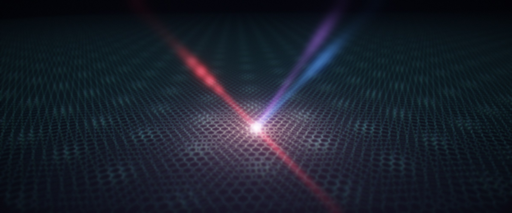

I am a tenure-track assistant professor in Experimental Condensed Matter Physics at the University of L'Aquila and co-lead the [Nonlinear Ultrafast Spectroscopy Laboratory](/lab/) with Carino Ferrante (CNR-SPIN). Our research combines femtosecond spectroscopy, nonlinear optics and Raman microscopy to investigate two-dimensional semiconductors, epsilon-near-zero materials, chiral systems, organic solar cells and biological samples.

[Explore the research](/research/) · [The laboratory](/lab/) · [Work with us](/lab/#collaborate-with-us)

## News

* **Nov 2026**: At IPC 2026 in Denver, I served as Topic Chair and presented work on femtosecond self-diffraction and Raman quantification of intracellular nanoplastics.
* **Oct 2026**: Our paper [Quantifying cellular nanoplastics accumulation using Raman microscopy](https://doi.org/10.1021/acsomega.6c06443) has been published in *ACS Omega*.
* **Oct 2026**: At NANOP 2026 in Rome, I presented our work on electron depletion in harmonic generation from an epsilon-near-zero (ENZ) material.
* **Sep 2026**: We organized the [EULiST Blended Intensive Programme "Principles of Quantum and Nonlinear Photonics"](https://eulist.university/2026/02/16/eulist-bip-principles-of-quantum-and-nonlinear-photonics-organised-by-univaq/) with TU Wien and Leibniz University Hannover.
* **Jun 2026**: We co-organized [ICOP 2026](https://www.icop2026.it/) and the co-located PhotoChi workshop on chirality in optics and photonics, in L'Aquila.

[All news](/news/)

## Research

In the laboratory we work in close collaboration with Andrea Marini on the theory of nonlinear and chiral light–matter interactions, with an interest in both fundamental light–matter interactions and spectroscopy-based applications. [More about my research](/research/)

Interested in a thesis, a PhD or a collaboration? See how to [join the lab](/lab/#join-the-lab) or how to [work with us](/lab/#collaborate-with-us).
