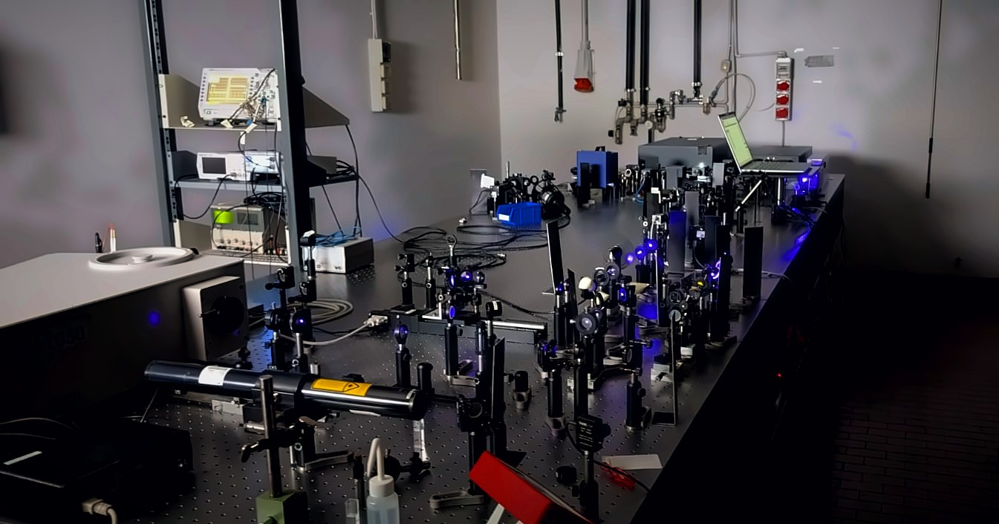
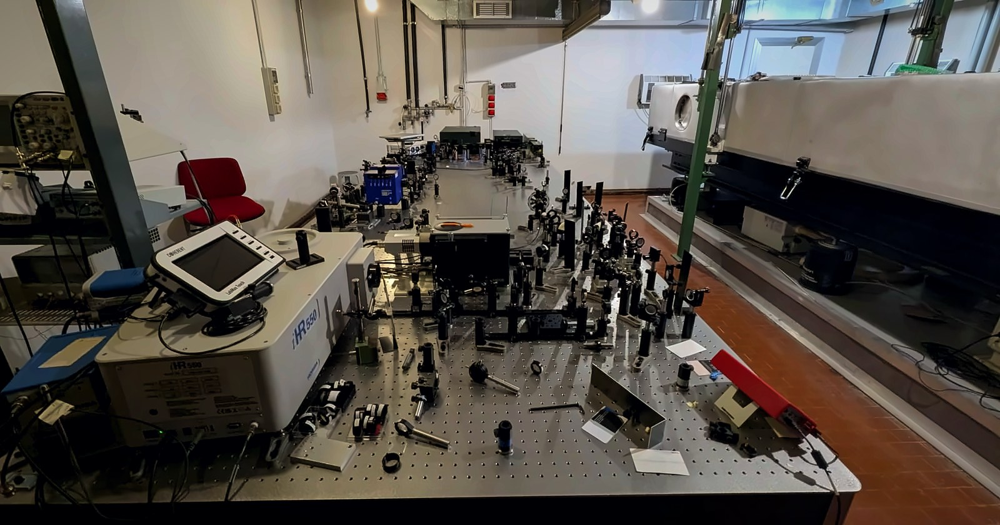

<figure>
  
  <figcaption>The femtosecond optical table, photographed with the room lights off: the violet light is the laser beam scattered by mirrors and optics.</figcaption>
</figure>

The laboratory is located in the Department of Physical and Chemical Sciences at the University of L'Aquila, on the Coppito campus, and is jointly operated by the University of L'Aquila and CNR-SPIN, the Institute for Superconductors, Innovative Materials and Devices of the Italian National Research Council. I coordinate the University of L'Aquila activities and co-lead the laboratory with Carino Ferrante (CNR-SPIN), in close collaboration with Andrea Marini on the theory of nonlinear and chiral light–matter interactions.

## Experimental techniques

* Femtosecond pump–probe and transient absorption
* Four-wave mixing and wavelength-resolved self-diffraction
* Second- and third-harmonic generation
* Chiroptical spectroscopies with circularly polarized light
* Raman and micro-Raman spectroscopy

## Equipment

* A Light Conversion PHAROS 20 W femtosecond laser coupled to an ORPHEUS optical parametric amplifier, delivering pulses tunable from 300 nm to 3 µm, with durations from 50 to 200 fs, at a repetition rate of about 100 kHz
* Visible and infrared spectrometers; the visible spectrometer is equipped with a camera acquiring at 100 kHz
* CCD cameras for imaging, including in the infrared
* An autocorrelator and an energy meter for pulse characterization
* A HORIBA confocal microscope for Raman and micro-Raman spectroscopy
* An INSTEC temperature stage for transient absorption measurements down to 77 K, with BNC feedthroughs for electrical connections, enabling operando measurements on devices

## Materials and systems

* Epsilon-near-zero (ENZ) conductive oxide films
* Organic solar cells
* 2D semiconductors and van der Waals heterostructures
* Chiral nanostructures, molecules and drugs in solution
* Biological samples

<figure>
  
  <figcaption>The laboratory with the lights on: the optical tables, the laser systems and the spectrometers.</figcaption>
</figure>

## Collaborate with us

If you are interested in applying ultrafast, nonlinear or Raman spectroscopy to your samples, please [contact me](mailto:davide.tedeschi@univaq.it?subject=Collaboration%20enquiry). We welcome discussions about collaborative measurements and joint projects.

In your first email, it helps to include:

* the material and its substrate
* the sample size
* the spectral range of interest
* the scientific question you would like to answer
* any reference measurements or controls you already have

We work in several ways: exploratory measurements, joint measurement campaigns, joint proposals for European projects and co-supervision of students. Please include "Collaboration enquiry" in the email subject line.

## People

* **Davide Tedeschi**, lab co-lead, University of L'Aquila
* **Carino Ferrante**, lab co-lead, CNR-SPIN
* **Luca Assogna**, PhD student in Physical and Chemical Sciences
* **Paola Benassi**, researcher, University of L'Aquila

## Alumni

* **Federico Perrella**, PhD in Physical and Chemical Sciences, now in industry
* **Giovanna Salvitti**, postdoctoral researcher, now in industry

## Join the lab

We offer Master's thesis and PhD projects in ultrafast spectroscopy, nonlinear optics and 2D materials. Examples of possible projects:

* Femtosecond transient absorption of 2D heterostructures
* Wavelength-resolved self-diffraction and the nonlinear susceptibility
* Harmonic generation in epsilon-near-zero materials
* Raman microscopy of nanoplastics in biological samples
* Chiroptical sensing of molecular solutions

**Who we are looking for.** Suitable backgrounds include physics, materials science, electronic engineering, physical chemistry and related fields. Previous experience with lasers is welcome but not required.

**What you will learn.** Femtosecond laser alignment and laser safety, pump–probe spectroscopy, polarization optics, optical data acquisition with LabVIEW, data analysis in Python and MATLAB, and scientific writing and presentation.

**PhD positions.** In Italy, PhD calls usually open in June and close in September. Postdoctoral positions are advertised when funding is available. In both cases you are welcome to get in touch before a call is published.

**How to apply.** [Send me](mailto:davide.tedeschi@univaq.it) a one-page CV, your current degree programme and a few lines about your research interests.
