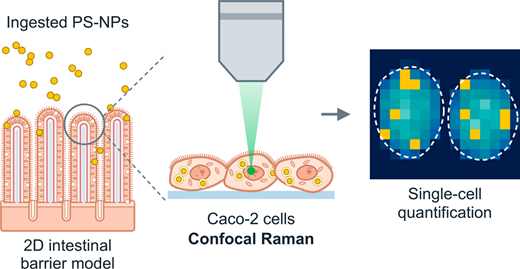
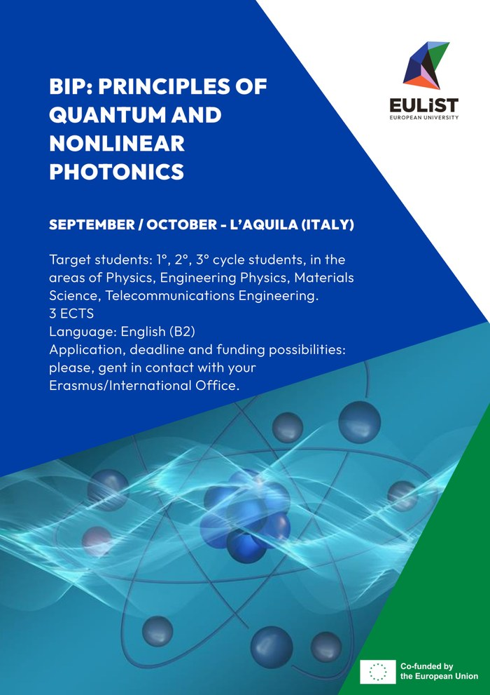
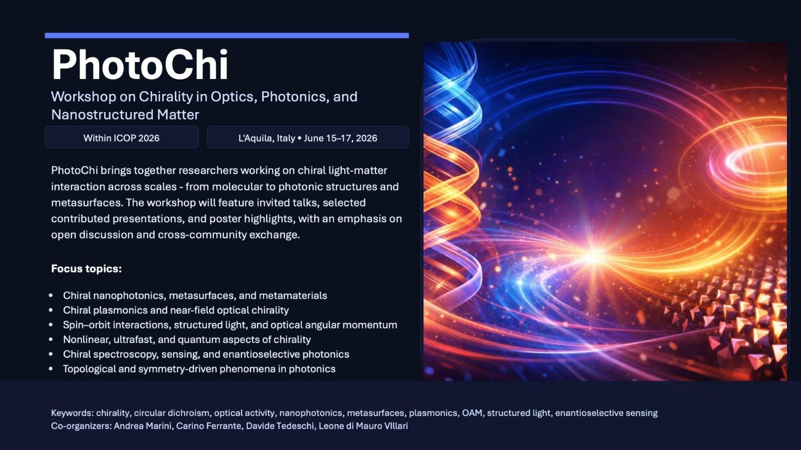
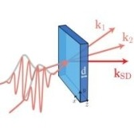

* **Nov 2026**: at the IEEE Photonics Conference (IPC 2026) in Denver, where I also served as Topic Chair, I presented two talks: "Femtosecond self-diffraction as a measure of the nonlinear response spectrum" and "Raman microscopy as a tool to quantify intracellular nanoplastics accumulation".
* **Oct 2026**: talk at NANOP 2026 in Rome on "The key role of electron depletion in second- and third-harmonic generation from an ENZ material".
* **Oct 2026**: our paper [Quantifying cellular nanoplastics accumulation using Raman microscopy](https://doi.org/10.1021/acsomega.6c06443) has been published in *ACS Omega*.

  

* **Sep 2026**: we organized the [EULiST Blended Intensive Programme "Principles of Quantum and Nonlinear Photonics"](https://eulist.university/2026/02/16/eulist-bip-principles-of-quantum-and-nonlinear-photonics-organised-by-univaq/) with TU Wien and Leibniz University Hannover, with an in-person week in L'Aquila from 21 to 25 September.

  

* **Jun 2026**: together with Andrea Marini, Carino Ferrante and Leone di Mauro Villari, we co-organized [ICOP 2026](https://www.icop2026.it/), the Italian Conference on Optics and Photonics, in L'Aquila, and the co-located [PhotoChi](https://www.icop2026.it/co-locaded-events/) workshop on chirality in optics, photonics and nanostructured matter (15–17 June).

  

* **May 2026**: the QuantERA III project SiNPhoni was selected for funding, with the University of L'Aquila as a partner.
* **Mar 2026**: our paper [Femtosecond self-diffraction as a measure of the nonlinear response spectrum](https://doi.org/10.1364/OL.582839), measured on the new L'Aquila setup, has been published in *Optics Letters*.

  

* **Nov 2025**: Topic Chair at the IEEE Photonics Conference (IPC 2025) in Singapore.
* **Jul 2025**: [Strain-induced exciton redistribution among quantum emitters in two-dimensional materials](https://www.nature.com/articles/s41699-025-00588-8) has been published in *npj 2D Materials and Applications*.
* **Jul 2025**: invited talk on nanophotonics for integrated chiroptical sensing of drug solutions at META 2025, Torremolinos.
* **Dec 2024**: invited talk on strain-induced exciton transfer among quantum emitters in 2D materials at ISSON 2024, Canberra.
* **Nov 2024**: joined the University of L'Aquila as a tenure-track assistant professor.
